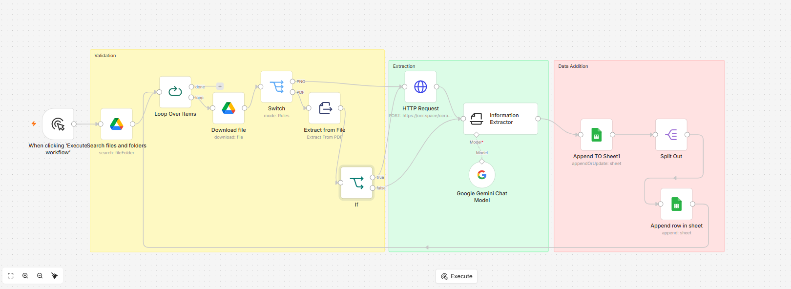

# AI-Powered Invoice Extraction & Automation

## Overview

This project automates invoice processing using n8n, Google Drive, Google Gemini, OCR/document extraction, and Google Sheets.

The workflow identifies invoice files, routes them according to file type, extracts relevant information using document extraction and AI, and records structured results in Google Sheets.

## Business Problem

Manual invoice processing can require repetitive work to locate documents, extract invoice information, organize line items, and enter the results into spreadsheets.

This workflow demonstrates how AI and workflow automation can reduce repetitive data-entry tasks and create a more consistent invoice-processing process.

## Workflow Architecture

1. **Trigger:** Start the workflow manually in n8n.
2. **File discovery:** Search Google Drive for invoice files.
3. **File processing:** Loop through the discovered files and download them.
4. **File routing:** Identify the appropriate processing path for PDFs and PNG images.
5. **Information extraction:** Extract document content and use Google Gemini to identify relevant invoice information.
6. **Data structuring:** Organize extracted information and process line items.
7. **Google Sheets integration:** Append or update structured information in the spreadsheet.

## Workflow Diagram

## Technology Stack

- n8n Cloud — workflow orchestration
- Google Drive — invoice file storage and retrieval
- Google Gemini — AI-powered information extraction
- OCR and document extraction — processing invoice content
- Google Sheets — structured output and record management

## Key Capabilities

- Automated invoice file discovery and processing
- PDF and PNG processing paths
- AI-assisted information extraction
- Structured invoice and line-item handling
- Automated spreadsheet updates
- Multi-step workflow orchestration

## Business Value

The workflow demonstrates how document-processing tasks can be automated to reduce manual effort, improve consistency, and make extracted invoice information easier to organize and review.

## Privacy and Security

This repository is intended for portfolio demonstration. No confidential invoices, credentials, API keys, or private business data should be committed to GitHub.

## Project Status

The n8n workflow has been implemented and tested. This repository documents the workflow architecture and demonstrates the implementation through a workflow screenshot.

## Disclaimer

This is an independent portfolio presentation. It does not publish confidential company workflows, customer information, or production credentials.

## Project Documentation

Detailed documentation for this project:

- [Workflow Architecture](docs/architecture.md)
- [Validation and Testing](docs/validation-and-testing.md)
- [Privacy and Security](docs/privacy-and-security.md)
